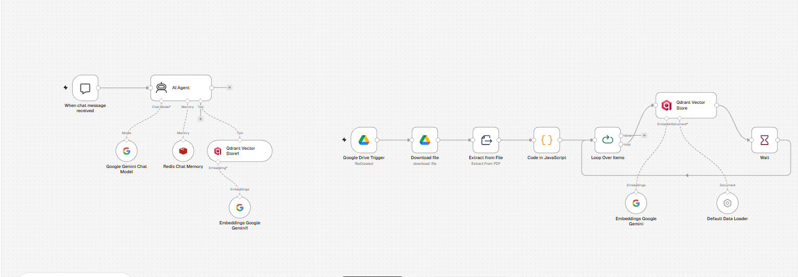
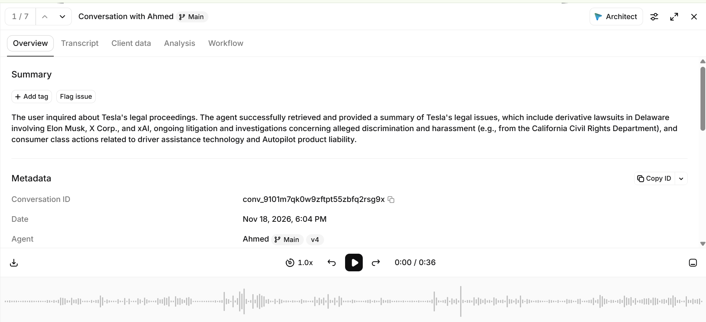
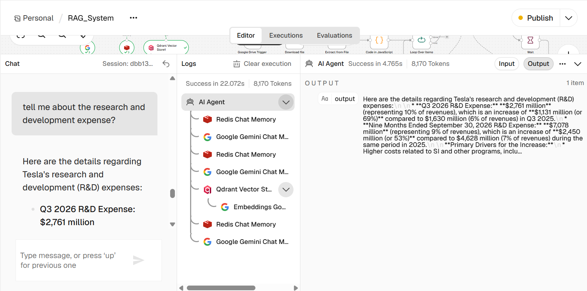
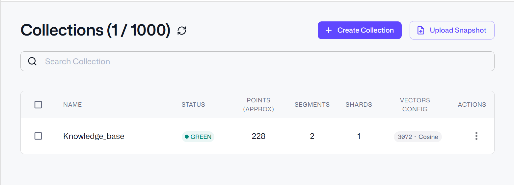
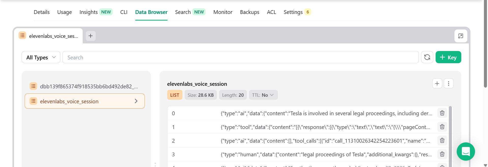

# Voice RAG Agent

A voice-enabled Retrieval-Augmented Generation (RAG) system built with n8n. Users ask questions by voice in English or Arabic and receive spoken answers grounded in a private document knowledge base. Speech input and output are handled through the ElevenLabs API, while n8n orchestrates retrieval and response generation.

## Features

- Bilingual (English/Arabic) voice interaction
- Automatic ingestion: PDFs added to a Google Drive folder are chunked, embedded and indexed
- Grounded answers retrieved from a Qdrant vector database
- Conversation memory stored in Redis
- Authenticated webhook between the voice layer and n8n

## Architecture

**Ingestion pipeline**

Google Drive Trigger → Download PDF → Extract text → JavaScript chunking (2,500 characters, 300 overlap) → Loop Over Items (batch of 3) → Gemini embeddings → Qdrant (`Knowledge_base`, 3072 dimensions, cosine similarity) → Wait (rate limiting)

**Query pipeline**

Voice interface (ElevenLabs API) → authenticated n8n webhook → AI Agent (Gemini chat model, Qdrant retrieval tool, Redis chat memory) → Respond to Webhook → answer spoken to the user

## Tech stack

| Layer | Tool |
|---|---|
| Orchestration | n8n Cloud |
| LLM | Google Gemini |
| Embeddings | Google Gemini embeddings |
| Vector database | Qdrant |
| Chat memory | Redis |
| Voice | ElevenLabs API |
| Document source | Google Drive (PDFs) |

## Demo

Evaluated on Tesla financial reports (about 228 indexed chunks). Example question: *"What legal proceedings is Tesla facing?"*

| Voice conversation | Chat test |
|---|---|
|  |  |

| Qdrant collection | Redis chat memory |
|---|---|
|  |  |

## Setup

1. In n8n, go to **Workflows → ⋯ → Import from File** and choose [`workflows/RAG_System.json`](workflows/RAG_System.json).
2. Create these credentials in n8n and attach them to the matching nodes:
   - Google Drive OAuth2
   - Google Gemini API key
   - Qdrant (cluster URL and API key)
   - Redis (host, port, password)
   - Header authentication for the webhook
3. Create a Qdrant collection with 3072 dimensions and cosine distance, matching the Gemini embedding model.
4. Point the Google Drive Trigger at your own folder and add a PDF.
5. Activate the workflow.
6. Configure your ElevenLabs agent to call the n8n webhook as a tool, sending the same authentication header.

## Security

- No secrets are stored in this repository. n8n exports reference credentials by name only.
- The webhook is protected with header authentication, and the same secret is configured on the voice side.
- `.gitignore` blocks `.txt`, `.env` and key or token files as a safety net.

## Known limitations and next steps

- Redis memory currently uses a single shared session key. Using the voice conversation ID as the session key would give each caller isolated memory.
- Tested with a single document set; multi-document and multi-tenant retrieval are not yet covered.
- Response latency has not been benchmarked end to end.

## Author

**Shayan Salam** · [github.com/ShayanSalam](https://github.com/ShayanSalam)
